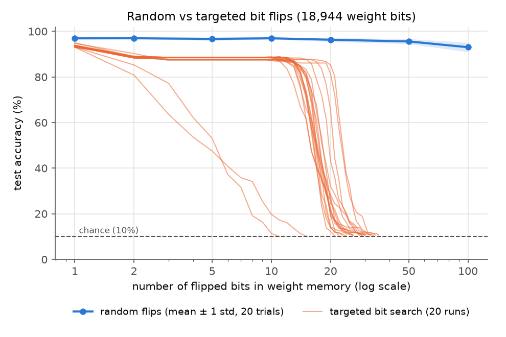
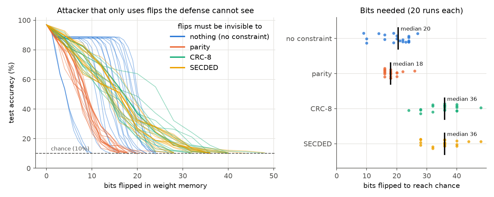
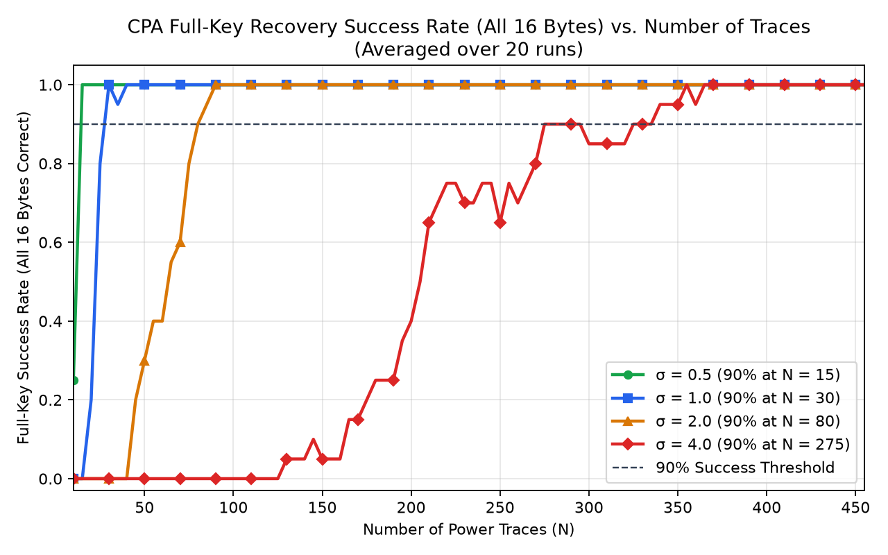
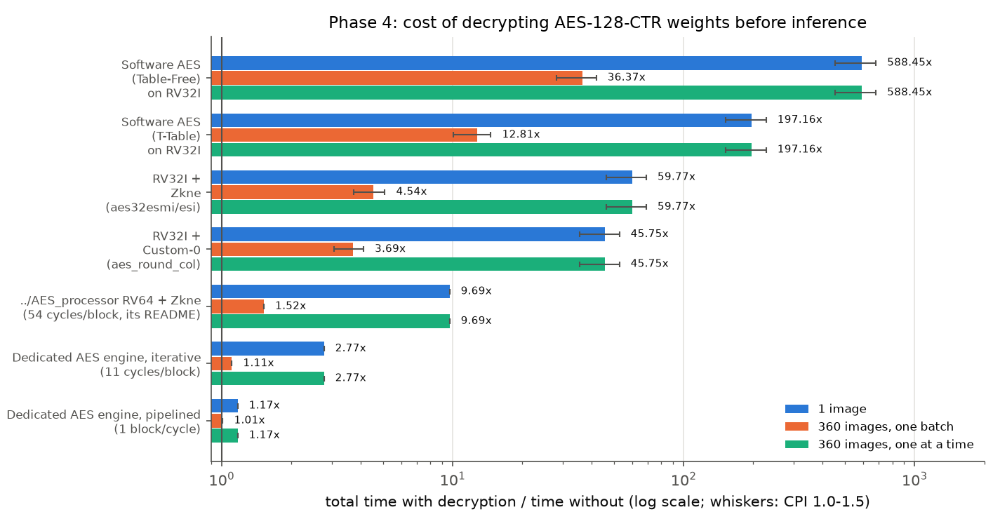
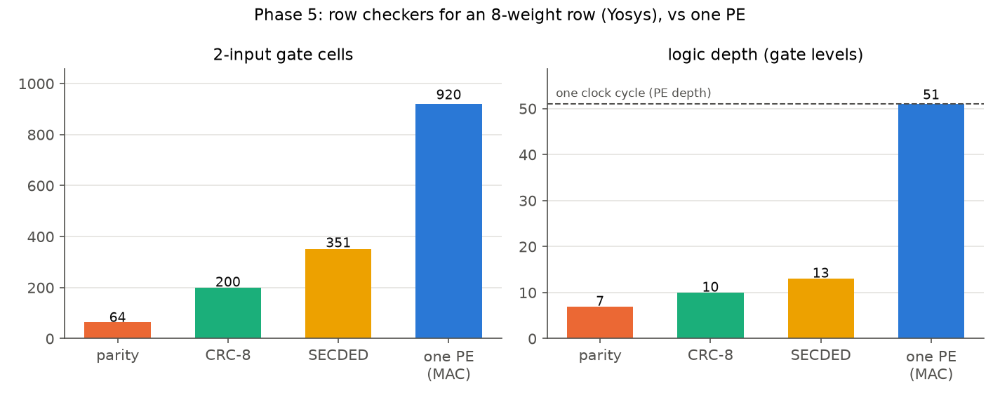

# Breaking and fixing a tiny ML accelerator: bit flips, power side channels, and what defenses cost

Honours project report, Semester 5 (draft for advisor review, 2026-10-22).
Everything here is a simulation of my own small model; nothing targets real hardware or
real systems. All numbers come from the saved results in `results/` and can be
regenerated with fixed seeds (commands in `PROGRESS.md`). Labels used throughout:
**measured** = simulated or synthesized in this project; **analytical** = a formula or a
published result, not measured here.

---

## 1. Problem

ML accelerators store model weights in memory and compute on them with arrays of
multiply-accumulate units. Two physical attack classes threaten them:

1. **Fault attacks on weight memory.** RowHammer can flip DRAM bits without accessing them
   (Kim et al., ISCA 2014). The Bit-Flip Attack (BFA) showed that a handful of carefully
   chosen weight-bit flips can destroy a quantized network's accuracy, while hundreds of
   random flips barely matter (Rakin et al., ICCV 2019).
2. **Power/EM side channels.** Correlation power analysis recovers secrets from leakage
   (Kocher et al., CRYPTO 1999; Brier et al., CHES 2004), and has been used to recover
   neural-network weights and architecture (Batina et al., USENIX Security 2019).

The question of this project: **for a small, fully simulated accelerator, how well do
standard defenses work, and what do they cost in memory, cycles, randomness and logic?**
The approach is "break and fix": build the target, attack it in simulation, add a
defense, and measure both the protection and the price.

## 2. Setup

- **Model.** MLP 64 -> 32 -> 10 with ReLU (scikit-learn `MLPClassifier`, seed 0) on the
  scikit-learn digits dataset, stratified 80/20 split (1,437 / 360 images). Symmetric
  per-layer INT8 quantization of weights and activations, int32 accumulators and biases.
- **Accelerator.** A cycle-by-cycle Python model of an 8x8 weight-stationary systolic
  array (inputs skewed by row, partial sums flowing down, 8x8 tiling). Per tile with M
  inputs: load 8 + fill 7 + compute M + drain 7 cycles; no overlap between tiles.
  Bias/ReLU/requantization run in an uncounted post-processing unit. The model's logits
  are bit-identical to a NumPy INT8 reference (tested on many shapes).
- **Weight memory.** All 2,368 INT8 weights as one flat memory of 18,944 bits. A "row" is
  the up-to-8 weights loaded into the array in one cycle (320 rows).
- **Side-channel evidence.** The merged AES track: AES-128 from scratch (FIPS-197
  verified) and simulated Hamming-weight traces with Gaussian noise attacked by CPA.
  No side-channel attack was run on the accelerator itself.
- **Hardware.** Row checkers written in Verilog, verified with Icarus Verilog against the
  Python models, synthesized with Yosys to 2-input gates.
- **RV32I counts.** The AES track's RV32I simulator measured instructions per AES block
  for software and instruction-set-extension variants.

## 3. Results

### 3.1 The target (Phase 1)

| | value (measured) |
|---|---|
| float test accuracy | 96.94% |
| INT8 test accuracy (NumPy and systolic model) | 96.94% (2 predictions changed, cancelling) |
| cycles, 1 image / 360 images | 920 / 15,280 |
| PE utilization, 360 images: layer 1 / layer 2 | 94.2% / 58.9% |
| PE utilization, 1 image: layer 1 / layer 2 | 4.3% / 2.7% |

With one image, almost every cycle is weight loading, filling and draining, which later
makes per-image defenses expensive. Plots: `../results/phase1/utilization_per_layer.png`,
`../results/phase1/cycles_vs_size.png`.

### 3.2 Bit flips in weight memory (Phases 2, 2b)

- **Random flips barely matter** (measured, 20 trials per point): 100 random flips leave
  93.06% ± 2.03% accuracy.
- **The targeted progressive bit search destroys the model** (measured, 20 runs with
  different attacker batches): chance level (<= 11%) after **11-35 flips (median 28.5)**,
  i.e. about 0.15% of the weight bits. 394 of the 536 chosen flips hit bit 7 (the sign
  bit) and 123 hit bit 6, matching the BFA paper's observation that high-order bits are the
  most damaging.

**Row checks.** One check per 8-weight row, verified as the row loads:

| | parity | CRC-8 (0x07) | SECDED (72,64) |
|---|---|---|---|
| extra memory | 320 bits (1.7%) | 2,560 (13.5%) | 2,496 (13.2%) |
| extra cycles, 1 image / 360 images | +40 (4.3%) / +40 (0.26%) | same | same (after Phase 5 update) |
| 2 flips in one row | missed 100% | detected | detected |
| 3 flips in one row | detected | detected | 75% mis-corrected |
| 4 flips in one row | missed 100% | 0.7% missed | 1.0% missed |
| false alarm, 1 random flip, check bits attackable | 1.2% | 11.1% | 0.0% |
| changed rows flagged, non-adaptive targeted attack (20 runs) | 388/456 | 456/456 | (corrects single flips) |

All rows are measured (1,000-2,000 trials per point). SECDED fully repairs 86% of trials
with 10 random flips; its mean accuracy after correction stays above 96% up to 100 flips,
but rows with 3+ flips are silently mis-corrected (almost always alongside an alarm from
another row). See `../results/phase2/same_row_outcomes.png` and
`../results/phase2/false_alarms.png`.

**Adaptive attacker.** All three codes are linear, so a flip pattern is invisible exactly
when the XOR of its bits' syndromes is zero. An attacker who knows the code can enumerate
the smallest invisible patterns (2 bits in a row for parity; 4 bits for CRC-8 and SECDED)
and run the same gradient-guided search over them:

| attacker restricted to flips invisible to | reached chance | bits needed, median (range) |
|---|---|---|
| nothing (control, same search) | 20/20 | 20 (9-27) |
| parity | 20/20, never flagged | 18 (16-26) |
| CRC-8 | 20/20, never flagged | 36 (24-48) |
| SECDED | 20/20, never flagged | 36 (28-48) |

So **none of the three codes stops an attacker who knows it**; CRC-8 and SECDED only double
the bits needed. Each code does catch attacks tailored to the *other* code (SECDED caught
every CRC-8-invisible attack and vice versa). This assumes the attacker can flip exactly
the bits it wants, which is much stronger than real RowHammer allows.

**Keyed MAC (Phase 2c, partial).** A truncated AES-CMAC per row (8 or 16 bits, covering
the row address) was implemented but is **untested, and no MAC experiments were run** (see
Section 5). Analytically, with an unknown key a changed row passes with probability 2^-t
(1/256 for t = 8, 1/65,536 for t = 16), r changed rows all pass with 2^-(t*r), and an
attacker who could retry after alarms needs about 2^t tries per row, so alarms must
trigger a response (reload or stop).

### 3.3 Power side channels (AES track, Phase 3)

Measured on the AES model (20 runs per point), 90% full-key recovery needed **15 / 30 /
80 / 275 traces at noise sigma = 0.5 / 1 / 2 / 4**, roughly proportional to sigma^2.

Two defenses were added to the accelerator model and costed (measured; logits
bit-identical, so clean accuracy is unchanged in every case):

| option | cycles, 1 image | cycles, 360 images | random bits, 360 images |
|---|---|---|---|
| no defense | 920 | 15,280 | 0 |
| shuffling, one order per batch | 920 | 15,280 | 604 |
| shuffling, new order per image | 920 | 331,200 (21.7x) | 217,440 |
| masking (2 multipliers/PE), masks per batch | 1,000 | 15,360 | 151,552 |
| masking (2 multipliers/PE), masks per image | 1,000 | 360,000 (23.6x) | 54.6 M |
| masking (1 widened multiplier, 2 passes), masks per batch | 1,920 | 30,640 | 151,552 |

Masking here stores each weight as two 8-bit Boolean shares, converts them at load time to
32-bit arithmetic shares with Goubin's conversion (CHES 2001), and multiplies the public
input by both shares in each PE. Shares must be 32 bits because narrow arithmetic shares
either wrap incorrectly or are non-uniform. This costs +88 register bits per PE (+5,632 in
the array), two 8x32 multipliers per PE, doubled weight memory, and 64 random bits per
weight per load.

The key finding is structural: **in a weight-stationary array, randomness refreshed per
weight load is shared by all images in a batch**, so images in a batch are not protected
from each other. Fresh randomness per image forces a reload per image (about 22-24x
slower for 360 images) or in-PE mask refresh needing up to 2,048 random bits per cycle.

*Expected effect (analytical, not measured):* shuffling over m positions reduces a
single-point attacker's correlation by about m (about m^2 more traces), or by about sqrt(m) for an
integrating attacker (about m more traces) (Mangard, Oswald, Popp 2007;
Veyrat-Charvillon et al., ASIACRYPT 2012); here m is roughly 32-2,048. First-order masking
should defeat first-order CPA and force a second-order attack whose trace count grows
roughly like sigma^4 instead of sigma^2 (Chari et al., CRYPTO 1999), but glitches in
hardware can still leak (Mangard, Pramstaller, Oswald, CHES 2005). Published masked NN
engines report large overheads (MaskedNet: 2.8x latency, 2.3x area; BoMaNet: 3.5% latency,
5.9x area, on different designs).

### 3.4 Encrypting the weights (Phase 4)

Weights stored with AES-128-CTR (148 blocks), decrypted before inference. RV32I counts
per block are measured by the AES track; CPI 1.3, the CTR overhead and engine timings are
assumptions:

| option | extra cycles, 1 image | 360 images, one batch | 360 images, one at a time |
|---|---|---|---|
| table-free software AES (RV32I) | +540,452 (588x) | +540,452 (36.4x) | 588x |
| T-table software AES (RV32I) | +180,471 (197x) | 12.8x | 197x |
| RV32I + Zkne | +54,064 (59.8x) | 4.5x | 59.8x |
| RV32I + custom AES column instruction | +41,174 (45.8x) | 3.7x | 45.8x |
| `AES_processor` RV64 + Zkne (54 cycles/block) | +7,992 (9.7x) | 1.5x | 9.7x |
| dedicated engine, iterative | +1,628 (2.8x) | 1.1x | 2.8x |
| dedicated engine, pipelined | +158 (1.17x) | 1.01x | 1.17x |

Only a dedicated engine keeps single-image inference cheap. Importantly, **CTR encryption
gives no integrity**: a flipped ciphertext bit flips exactly the same weight bit (tested),
so the bit-flip attack works unchanged on encrypted weights. Encryption must be paired
with a row check or a MAC.

### 3.5 Hardware row checkers (Phase 5)

All three checkers pass a self-checking Icarus testbench against the Python models
(2,380 vectors for 8-byte rows, 540 for 2-byte rows). Yosys results (2-input gates):

| design | cells | depth (gate levels) |
|---|---|---|
| parity, 8-byte row | 64 | 7 |
| CRC-8, 8-byte row | 200 | 10 |
| SECDED decoder/corrector, 8-byte row | 351 | 13 |
| one PE multiply-accumulate (clock reference) | 920 | 51 |

Every checker fits well within one PE cycle and is under 1% of the 64 PEs' logic. This
**corrected an earlier assumption**: SECDED was assumed to need 2 cycles per tile; it needs
1, so its cost dropped from +80 to +40 cycles per inference (Phase 2b results re-run).

### 3.6 Dashboard

`results/dashboard.html` (self-contained, offline) lets the reader toggle each defense,
move sliders for the number of flipped bits and the noise level, and see accuracy,
detection, false alarms, side-channel cost and total cycles/memory/randomness. Analytical
entries are labelled in the page.

## 4. Related work

- **Bit-flip attacks on DNNs.** RowHammer (Kim et al., ISCA 2014) enables software-induced
  DRAM bit flips. Hong et al. (USENIX Security 2019) showed that most DNN models have
  single parameters whose bit flip drops accuracy by over 90%. Rakin et al. (ICCV 2019)
  introduced the progressive bit search (BFA) used in Phase 2 (13 flips break ResNet-18).
  DeepHammer (Yao et al., USENIX Security 2020) demonstrated targeted chains of bit flips on
  real systems.
- **Defenses against bit flips.** He et al. (CVPR 2020) harden the model itself
  (binarization-aware training, piece-wise clustering). RADAR (Li et al., DATE 2021) uses
  per-group checksums with 2-bit signatures, close in spirit to our row checks; later work
  notes such checksums can be bypassed by an attacker who targets them, which our adaptive
  attacker confirms for linear codes. Classic codes: SECDED (Hsiao, IBM J. R&D 1970) and
  CRC polynomial selection (Koopman and Chakravarty, DSN 2004).
- **Side channels and NNs.** DPA (Kocher et al., CRYPTO 1999) and CPA (Brier et al., CHES
  2004) are the attack foundations; CSI NN (Batina et al., USENIX Security 2019) recovered
  NN architecture and weights via EM. Countermeasures: masking (Chari et al., CRYPTO 1999;
  Goubin, CHES 2001), its hardware pitfalls (Mangard et al., CHES 2005), shuffling
  (Veyrat-Charvillon et al., ASIACRYPT 2012), and masked NN engines (MaskedNet, HOST 2020;
  BoMaNet, ICCAD 2020).
- **Accelerators.** The TPU (Jouppi et al., ISCA 2017) popularized weight-stationary
  systolic arrays for inference; the systolic idea goes back to Kung (IEEE Computer 1982).

## 5. Limits

- **Everything is simulated.** No real DRAM, no measured power traces, no silicon. The
  accelerator is tiny (2,368 weights, 360 test images; one test image = 0.28 points).
- **Strong attacker model in Phase 2b.** The adaptive attacker can flip exactly chosen bit
  patterns. It only searches the smallest invisible patterns and the top 200 candidates per
  round, so its bit counts are upper bounds.
- **Phase 2c is partial.** The MAC module is built but untested; no MAC experiments were
  run because my responses were stopped three times by a safety filter while writing the
  MAC experiment code, so that work was not continued. All MAC numbers in this report and
  the dashboard are **analytical** (2^-t per changed row) or **assumed** (11 cycles per tile).
- **Analytical-only entries.** The effect of shuffling and masking on trace counts, the
  MAC detection probabilities, and the masking/shuffling literature comparisons are not
  measured here. No side-channel attack was run on the accelerator.
- **Cycle assumptions.** The Goubin converter latency (2 cycles), the permutation generator
  overlap, the MAC engine (11 cycles), the AES engines, the 17-instruction CTR overhead and
  CPI 1.3 are assumptions. Only the row checkers' latency was checked in hardware, and only
  as gate depth (no cell library, no wire delay).
- **Composition.** Dashboard totals add up separately measured costs; interactions are not
  simulated. Only the multiply step is masked; post-processing is unmasked. Nonces, key
  management and alarm responses are not modelled.

## 6. Gaps and future work (for discussion with my advisor)

1. **Alarm response.** Model what happens on an alarm (reload clean weights, stop after k
   alarms) and measure availability vs security; this is what makes a MAC meaningful.
2. **Finish Phase 2c properly.** Unit tests for the MAC module and its random-fault
   behaviour under the Phase 2b seeds (the defensive measurements), with a five-defense table.
3. **Combined codes.** Since each linear code catches the other's invisible patterns,
   measure CRC-8 + SECDED together, and compare against a MAC.
4. **Realistic fault model.** Restrict flips to plausible RowHammer patterns (vulnerable
   cells, page layout, flip direction) instead of arbitrary bit choices.
5. **Side-channel leakage of the defended accelerator.** Simulate leakage of the masked and
   shuffled array (including glitch-like effects) and run standard leakage tests (e.g.
   TVLA-style t-tests) rather than relying on analytical expectations.
6. **Hardware for the rest.** Verilog for the Goubin converter, MAC engine and AES engine,
   synthesis with a real standard-cell library for area and timing.
7. **Overlap and scheduling.** Precompute the CTR keystream and permutations while the
   previous layer runs; double-buffer weight tiles to cut batch-1 overhead.
8. **Bigger models.** Repeat on a CNN to see whether the "flips needed" and cost ratios
   scale as the literature suggests.

## References

Checked online in this project (existence, venue; content as summarised in public
abstracts or the papers' own pages): Kim et al. ISCA 2014; Rakin, He, Fan ICCV 2019;
Hong et al. USENIX Security 2019; Yao, Rakin, Fan USENIX Security 2020; He et al. CVPR
2020; Li et al. DATE 2021; Hsiao IBM J. R&D 14(4) 1970; Koopman and Chakravarty DSN 2004;
Kocher, Jaffe, Jun CRYPTO 1999; Brier, Clavier, Olivier CHES 2004; Batina, Bhasin, Jap,
Picek USENIX Security 2019; Chari, Jutla, Rao, Rohatgi CRYPTO 1999; Goubin CHES 2001;
Mangard, Pramstaller, Oswald CHES 2005; Mangard, Oswald, Popp, *Power Analysis Attacks*,
Springer 2007; Veyrat-Charvillon, Medwed, Kerckhof, Standaert ASIACRYPT 2012; Dubey,
Cammarota, Aysu HOST 2020 (MaskedNet) and ICCAD 2020 (BoMaNet); Jouppi et al. ISCA 2017.

**Not verified online in this project:** H. T. Kung, "Why Systolic Architectures?", IEEE
Computer, 1982 (a search returned no matching record). Standards used but not re-checked:
NIST SP 800-38A (CTR mode), NIST SP 800-38B (CMAC), RFC 2104 (HMAC), RISC-V Scalar
Cryptography extension (Zkne).
